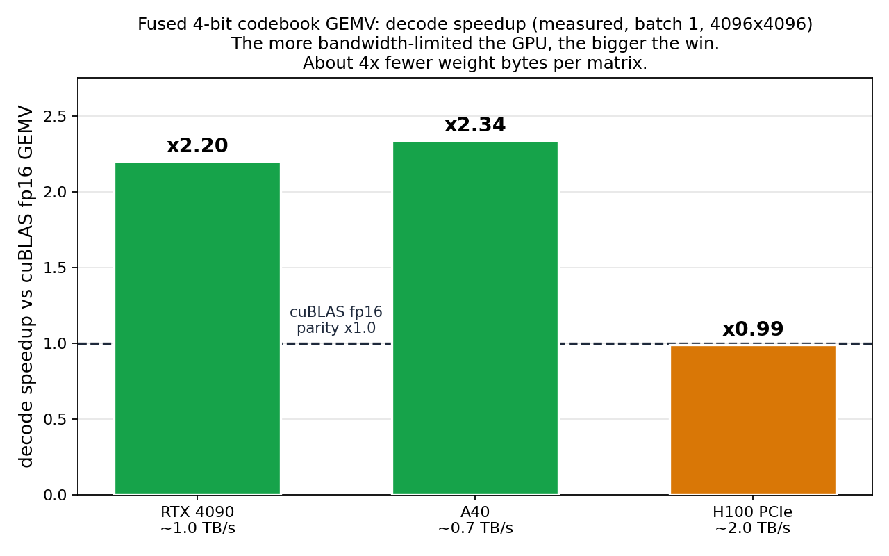

# Trapetum

*Press the model, keep the oil.* A **trapetum** is the Roman olive press: it crushes the
whole fruit to extract the concentrated essence. This project does the same to an LLM,
pressing the weights down to a small **codebook** and decoding them straight inside the
matmul, so the dequantized weight matrix `W` is never materialized in global memory.

It is fused CUDA kernels for **codebook (non-uniform / k-means) weight quantization** plus
a pure-Rust runtime. A real Llama-2-7B, quantized to 4-bit, runs end-to-end in Rust with
**no Python at runtime**, reproducing HuggingFace token for token (16/16). In June 2026 it
decoded at 135 tok/s at short context on an RTX 4090, with 2.1x less energy per token than
fp16 over a 512-token generation (see [`bench/PARETO.md`](bench/PARETO.md); energy not
re-measured since). With the November 2026 kernels and the new exporter's file it decodes at
194.5 tok/s (RTX 4090, CUDA graph, mean over a 512-token generation), still 16/16. The 4-bit
file is 3.66 GB instead of 13.48 GB in fp16, 3.7x smaller (the new exporter's file is
3.75 GB, 3.6x). The same runtime serves Llama-2-70B in 2 bits on one RTX 4090: 38.4 tok/s at
positions 6 to 22, wikitext-2 perplexity 4.49 on the full test set, against 5.72 for the new
7B 4-bit file and 5.47 for fp16 Llama-2-7B ([details](#llama-2-70b-in-2-bits-on-one-rtx-4090)).
Its PV-tuned 1x16 version scores 4.02 and decodes at 22.5 tok/s with exact speculative
decoding, a 2-bit Llama-2-7B drafting ([details](#llama-2-70b-pv-tuned-in-1x16-with-exact-speculative-decoding)).
Llama-3.1-70B-Instruct, a conversational 70B, also PV-tuned in 1x16, reaches 21.3 tok/s on chat
prompts with exact speculative decoding from a 2-bit Llama-3.1-8B-Instruct drafter
([details](#llama-31-70b-instruct-on-one-rtx-4090-with-exact-speculative-decoding)).

> **Correction, November 2026.** The 4-bit Llama-2-7B perplexity published here until now
> (wikitext-2 PPL 6.34) came from a research script, not from the runtime's 4-bit file,
> which measures 6.79 in the same harness; the new exporter's file measures 6.10. The claim
> that 2-bit "trades +0.33 PPL" is withdrawn. Earlier versions also gave this file as 3.5 GB and
> 3.9x smaller than fp16, a MiB figure written as GB: it is 3.66 GB (3.75 GB for the new
> exporter's file), 3.7x (3.6x) smaller than the 13.48 GB of fp16 weights. Details, and the decode work of November 2026
> (split-KV attention, fused kernels, opt-in sparsity, a tensor-core GEMV with a
> batch-invariant verify, PARD speculative decoding), are in the
> [November 2026 update](#november-2026-update).

```
W_deq[i, j] = codebook[ indices[i, j], j ]            # per-output-channel codebooks
Y[m, j]     = sum_i  X[m, i] * W_deq[i, j]
```

- `indices` : `[IC, OC]`, one cluster id per weight (`uint8`, or packed `4-bit`)
- `codebook`: `[K, OC]`, `fp16` (small per-column table, `K` in 16..256)
- `X`       : activations `fp16`; `Y`: output `fp16`

## November 2026 update, in brief

| change | result (RTX 4090, CUDA graph; Llama-2-7B 4-bit unless noted) |
|---|---|
| new exporter (E[x^2]-weighted k-means, 8-bit LM head), now the default | wikitext-2 PPL 6.10, against 6.79 for the legacy file (published as 6.34) and 5.83 for fp16 (30 windows of 2,048 tokens) |
| split-KV decode attention | 4.3x faster decode at 1,024 positions (146.2 against 34.3 tok/s, same host) |
| fused decode kernels | 6.36 to 5.28 ms per token over the first 128 positions |
| opt-in activation sparsity at 25% (lossy) | 1.16x faster decode for +0.12 PPL |
| tensor-core 4-bit GEMV, batch-invariant verify | 194.5 tok/s (512-token benchmark); verifying 16 tokens costs 1.21x a decode step at short context |
| PARD speculative decoding, Llama-3.1-8B-Instruct | 2.51x end to end (165.5 to 415.6 tok/s); 520 of 520 outputs identical to plain greedy decoding of the same 4-bit target |
| Llama-2-70B in 2 bits (AQLM 2x8, 17.96 GB file) on one RTX 4090 | wikitext-2 PPL 4.49 on the full test set (4.68 on 30 windows), against 5.72 (6.10) for the new 7B 4-bit file; 38.4 tok/s at positions 6 to 22; greedy 16/16 against the Hugging Face reference |
| Llama-2-70B PV-tuned in 2 bits (AQLM 1x16, 18.54 GB file) on one RTX 4090 | wikitext-2 PPL 4.02 on the full test set (4.17 on 30 windows); 8.5 tok/s plain, 22.5 tok/s end to end with exact speculative decoding (2-bit Llama-2-7B drafter, K = 7); 36 of 36 outputs (K = 3, 7 and 15) identical to plain greedy decoding |
| Llama-3.1-70B-Instruct PV-tuned in 2 bits (AQLM 1x16, 21.00 GB file) on one RTX 4090 | 21.3 tok/s end to end with exact speculative decoding over 16 chat prompts (2-bit Llama-3.1-8B-Instruct drafter, K = 7), 7.9 plain in the same harness; 32 of 32 outputs (K = 3 and 7) identical to plain greedy decoding; wikitext-2 PPL 6.28 on the full test set (6.62 on 30 windows; Llama 3 tokenizer, not comparable with the Llama 2 rows) |

Setup, caveats, per-step details and how to reproduce:
[November 2026 update](#november-2026-update), under *Benchmarks*. The kernel changes are CUDA
only (Apple Metal is unchanged). The code is on `main` (commits 2e8c170 to 6b8cb42); the
desktop app's downloadable models are not updated.

## Repository layout

- [`kernels/`](kernels/): the CUDA kernels (scalar decode, prefill, and the additive
  vector-quantization kernel `avq_gemv*.cu`), their PyTorch binding (`quant_demo.py`),
  and the build/run harness (`benchmark.py`, `shapes_test.py`).
- [`model/`](model/): model-level scripts on Llama-2: the cast-free CUDA-graph serving
  integration that realizes the 2.0x/2.45x end-to-end decode speedup, the AQLM-style
  additive-VQ training that beats the unweighted scalar codebook, the accuracy probes, and the
  **torch-free exporter** (`export_safetensors.py`): it reads `safetensors` directly
  (no transformers; PyTorch only for its optional GPU k-means) and compresses any Llama- or Phi-3-architecture model
  to the runtime's format: this is how Phi-4 (14B) was exported and run at 79.9 tok/s.
  Nine architectures run end-to-end in pure Rust, including Gemma-2-9B, Phi-4 and
  DeepSeek-V2-Lite (MLA + MoE); see [`bench/RESULTS_models.md`](bench/RESULTS_models.md).
  Scale result: **DeepSeek-R1 671B** (full V3 architecture), 1.34 TB bf16 compressed to
  a 350 GB 4-bit artifact (exported by the streaming Python script `model/export_deepseek_stream.py`),
  serves the **full model at 2.46 tok/s** on a single cloud node with one GPU (64 vCPU, one L40S,
  497 GB RAM): **10.2x** its first CPU-experts run on the same node type (0.24 tok/s) and about 7x GPU
  offload on that node type (about 0.3 tok/s, 2.9 s/token); an earlier disk-bound run on an RTX 4090 host also gave 0.24 tok/s. The lever is **inversion**: the routed experts stay resident in host RAM and
  are decoded in place on the CPU (one 128-bit `vpshufb` per 16 weights on AVX2), while the GPU
  holds MLA attention, the dense layers and the shared experts (VRAM was not logged in these
  runs; an earlier disk-fed run of the same artifact on one RTX 4090 peaked at 20.9 GB). At batch one only the
  ~10 GB of routed-expert bytes per token matter, and they no longer travel to the GPU.
  The gain came in seven measured steps: 0.24, 0.44, 0.96, 1.31, 1.35, 1.67,
  1.84, 2.46 tok/s. Routed decode reached ~67 GB/s aggregate, near the memory read floor; at
  2.46 tok/s each 407 ms token splits into about 150 ms of routed decode on the CPU, 164 ms of
  GPU attention and 90 ms of work stealing.
  Quality (wikitext-2 PPL, measured on DeepSeek-V2-Lite with its own exporter,
  `model/export_deepseek.py`; the 671B itself was not measured): full 8-bit is essentially lossless at +0.03% vs fp16 (5.70);
  4-bit costs +7.1% (6.10); a mixed-precision variant (shared experts + lm_head at 8-bit)
  captures most of the recovery at **+1.5%** (5.78), for a projected +0.7% size on the 671B.
  See [`bench/RESULTS_deepseek.md`](bench/RESULTS_deepseek.md).
- [`bench/`](bench/): a fair single-harness speed vs accuracy vs memory benchmark of
  fp16, AWQ and AQLM (the `pareto`/`mem70` figures and `results*.json`).
- [`paper/`](paper/): the write-up (`trapetum.pdf`).
- [`runtime/`](runtime/): a minimal **Rust** runtime that hosts the CUDA kernel with no
  Python in the loop (the bootstrap of a deployable, single-binary inference path).

## Scope (read this first)

This repository is a **kernel-level study**, not a quantization *method* paper.

- It measures **throughput / latency** of fused dequant + GEMV/GEMM kernels versus
  cuBLAS fp16, on **synthetic** matrices with **random** codebooks and indices.
- It now also takes the scheme to a real model end to end (Llama-2 7B, see
  *Model-level results* below): the kernel is wired into PyTorch and the scheme's
  accuracy and memory are measured. The scheme implemented here (scalar
  per-output-channel codebooks) is the SqueezeLLM family; on *accuracy* at low bits
  it is behind vector/lattice/trellis methods (AQLM, QuIP#, QTIP), which we confirm
  directly below.
- Kernel correctness means **numerical agreement with a cuBLAS reference** on the
  same random data (max relative error reported), separate from model accuracy.

The contribution is the fused-decode **kernel** (and now its end-to-end memory /
speed on a real model); the value is memory and decode speed, not accuracy.

## Why fuse

Storing each weight as a small cluster index shrinks the layer 2x (uint8) to 4x
(4-bit). Dequantizing in a separate pass (write `W`, then GEMM) wastes the
bandwidth the quantization just saved. These kernels fold the lookup into the
matmul so the dequantization adds no extra global traffic.

## Does it run on your GPU?

Trapetum runs on any modern **NVIDIA** GPU with CUDA, and on **Apple Silicon** with Metal
(4-bit only). For NVIDIA, recompile the kernel for your architecture with one `-arch` flag, or
ship a multi-arch build that covers them all in a single binary. The 4-bit memory saving is
universal; only the speedup depends on the card (the bandwidth law: largest on the most
bandwidth-limited cards, 2.34x on an A40 and up to 2.2x on consumer GPUs, parity on an H100 PCIe).

| Your GPU | Arch | Memory win | Decode speed |
|---|---|---|---|
| RTX 30 / 40 (3060, 3090, 4070, 4090, ...) | `sm_86` / `sm_89` | 3.6-3.7x disk / 2.9x VRAM | strong, up to 2.2x |
| A100 / A40 / L40 | `sm_80` / `sm_86` / `sm_89` | 3.6-3.7x disk / 2.9x VRAM | largest, 2.34x on A40 |
| H100 PCIe (H200 untested) | `sm_90` | 3.6-3.7x disk / 2.9x VRAM | parity (fp16 already near roofline) |
| Turing and older (GTX 16, RTX 20, V100) | `sm_70` / `sm_75` | 3.6-3.7x disk / 2.9x VRAM | untested, rebuild needed |
| Apple Silicon (M1 to M4; measured on an M4) | Metal | same 4-bit file, in unified memory | supported for 4-bit; the 2-bit path and the November 2026 kernels are CUDA only |
| AMD GPUs, CPU-only machines | - | - | not supported (an NVIDIA or Apple GPU is required) |

Memory, labeled (both hold, they measure different things): **3.6x to 3.7x smaller on disk**
(a 3.75 GB `.cbk` codebook file from the new exporter, 3.66 GB from the legacy one, vs
13.48 GB fp16) and **2.9x less VRAM at runtime** (13.6 GB -> 4.7 GB peak).

The memory win (a 7B in 3.66 to 3.75 GB, so it fits an 8 GB card) holds on every NVIDIA GPU.
The June 2026 kernels were validated on Ampere, Ada and Hopper (`sm_80` to `sm_90`); every
November 2026 kernel was measured on an RTX 4090 (`sm_89`), the fused decode kernels also on an
A40. Pre-Ampere is untested, and the `mma.sync` / `cp.async` prefill paths require `sm_80+`.

## Benchmarks

Unless a row says otherwise, reference numbers below were measured on a single
**NVIDIA A40** (`sm_86`, CUDA 11.8) with matrices `IC = OC = 4096`, fp16
activations/output (the cross-GPU section adds RTX 4090 and H100). Every kernel is
checked for numerical correctness against cuBLAS on the same data.

**Reproducibility.** All randomness is generated by `std::mt19937(0)` in the CUDA
sources (fixed **seed = 0**). Timings use `cudaEvent` over 50..500 iterations after
a warm-up. Regenerate the full table on your own GPU with `python kernels/benchmark.py`
(auto-detects arch; writes `results.json` + `results.md` with the GPU, driver and
CUDA version captured).

### Decode regime (GEMV, batch M = 1, memory-bound)

| Kernel | scheme | latency | vs cuBLAS | max rel. err |
|---|---|---:|---:|---:|
| cuBLAS fp16 dense (baseline) | dense fp16 | 0.0612 ms | 1.00x | - |
| `gemv_codebook.cu` | uint8, K = 256 | 0.0562 ms | 1.09x | 2.9e-5 |
| `gemv_codebook.cu` | uint8, K = 64 | 0.0389 ms | 1.57x | 2.4e-5 |
| `gemv_codebook_4bit.cu` | 4-bit, K = 16 | 0.0261 ms | **2.34x** | 2.6e-5 |

Decode is memory-bound, so reading fewer weight bytes directly buys latency. The
dominant cost is streaming the index matrix; the lever is bits per index.

### Cross-GPU decode: the bandwidth law (4-bit, K = 16)

The 4-bit fused GEMV (`gemv_codebook_hopper_v2.cu`) was re-measured against a *live*
cuBLAS fp16 GEMV on three GPUs (same `4096x4096`, batch 1, seed 0, rel. err ~3e-4):



| GPU | bandwidth class | speedup vs cuBLAS fp16 |
|---|---|---:|
| RTX 4090 (`sm_89`) | ~1.0 TB/s | **x2.20** |
| A40 (`sm_86`) | ~0.7 TB/s | **x2.34** |
| H100 PCIe (`sm_90`) | ~2.0 TB/s | x0.99 (tie) |

**The more bandwidth-limited the GPU, the bigger the win**, because the kernel reads
1/4 the weight bytes. On bandwidth-bound GPUs (A40, RTX 4090) that is a ~2.2-2.3x decode
speedup, for about 4x fewer weight bytes per matrix (3.6-3.7x smaller on disk at model
level). On a bandwidth-rich H100 PCIe, fp16 GEMV is already
near-roofline, so the kernel only ties cuBLAS and the gain there is memory, not speed.

A recorded **negative result**: a Hopper variant that staged the codebook in
thread-block-cluster distributed shared memory (`gemv_codebook_hopper.cu`) came out
~100x slower. A small codebook wants *local* shared-memory reads in the hot loop, not
remote DSMEM. Kept in the repo as a documented dead end, alongside an L2-codebook /
X-staging sweep (`gemv_codebook_hopper_v3.cu`) where every variant regressed.

### PyTorch binding and per-layer speedup

`quant_demo.py` wraps the kernel as a torch custom op (`codebook_gemv`) plus a
per-column k-means quantize recipe, verified end to end on a real weight (rel. err
2.3e-7 vs the reconstruction). The decode speedup vs a torch dense fp16 mat-vec
(`torch.mv`, the batch-1 path a real fp16 `Linear` runs) grows with layer size,
measured on an RTX 4090:

| layer (IC x OC) | speedup vs torch dense fp16 |
|---|---:|
| 3072 x 768 (small)        | x0.58 (loses, overhead bound) |
| 4096 x 4096               | x2.10 |
| 11008 x 4096 (MLP down)   | x3.70 |
| 4096 x 11008 (MLP up)     | x3.77 |

Tiny matrices are overhead bound and lose; the large MLP layers that dominate an
LLM parameter count win x3.7. Apply the kernel selectively to the large layers.
Reproduce with `python kernels/shapes_test.py`.

### Model-level results (Llama-2 7B)

The scheme was taken all the way to a real model (scripts in [`model/`](model/); full
write-up in `paper/trapetum.pdf`).

**Memory.** Quantizing all 224 projection layers to 4-bit drops peak VRAM from
13.56 GB to 4.63 GB (**2.9x**); the 7B model runs in under 5 GB on a consumer card.

**Decode speed vs the real cuBLAS path.** Against `F.linear` (cuBLAS GEMV, not the
weak `torch.mv`), the kernel runs the 224-GEMV decode work of one token at **172
tok/s versus 70 (x2.4)**, both CUDA-graph captured, so the kernel genuinely beats
cuBLAS at batch 1. A naive per-layer custom-op swap loses end to end (x0.73) only
because of per-op `float32->float16` casts in the wrapper, not the kernel. Building
the clean integration (kernel writes fp16 into preallocated buffers, decode step
captured as one CUDA graph over a static-cache loop) **realizes the win: the codebook
model decodes 123.4 vs 61.6 tok/s vs fp16 (x2.0 end-to-end) at 4.73 vs 13.58 GB.** The
arc is x0.73 (naive) -> x0.85 (cast-free eager) -> **x2.0 (CUDA-graphed)**. The win
grows with size and bandwidth-boundedness: Llama-2 13B on an A40 decodes 49.0 vs 20.0
tok/s (**x2.45**) at 8.50 vs 26.17 GB (3.08x less).

**Accuracy, and its ceiling.** wikitext-2 PPL goes 5.83 (fp16, custom codebook
evaluation harness used for the ablations) -> 6.34 (4-bit codebook from the research
script: unweighted k-means from a mid-grid start, LM head kept in fp16; not the runtime's
file, which measures 6.79, while the November 2026 exporter's file measures 6.10, see the
[correction](#correction-4-bit-perplexity)). Three attempts to close the gap to AWQ fail: a
simple activation-aware calibration reaches 6.17, the full AWQ pipeline (output-error scale
search + weight clipping) does not improve on it (6.21), a naive vector quantizer is
catastrophic (diverges, with or without per-channel normalization), and incoherence
processing (a random orthogonal rotation before quantizing, the QuIP# lever) moves it only
marginally (6.34 -> 6.29). One later recipe does help: weighting every k-means centroid
update by E[x^2] of its input channel (128 wikitext-2 train windows) reaches 6.10, and the
exporter now uses it by default, with an 8-bit LM head (6.10; 5.72 on the full test set,
fp16 5.47). AWQ's scaling assumes a uniform grid while a codebook is already adaptive; real
vector/trellis accuracy needs AQLM/QuIP#-level machinery (residual codebooks, incoherence
paired with vector quantization, fine-tuning). **The value of this scheme is memory and
kernel speed; the new exporter narrows the gap to fp16 (72% smaller than the legacy file's
in this harness) but does not close it.**

### Toward vector codebooks: a fused additive-VQ decode kernel (preliminary)

The scalar codebook's accuracy ceiling is structural (above). The accuracy frontier is
*vector* quantization (AQLM, QuIP#): a group of `D` weights is reconstructed as a SUM of
`M` codebook vectors, `w_group = sum_m C_m[code_m]`, which reaches near-fp16 quality at
2 bits. Their kernels are the bottleneck. `avq_gemv.cu` is a first fused decode kernel
for exactly this scheme. The trick: in `y[o] = sum_g <x_g, w_group>`, the dot
`<x_g, C_m[k]>` is independent of the output, so a per-group LUT `LUT[m][k] = <x_g,
C_m[k]>` is built once in shared memory, then `y[o] = sum_g sum_m LUT[m][code_m[o,g]]`.
The kernel reads the **codes**, never the dense weight: at 2 bits (M=2, K=256, D=8) that
is 4.2 MB of codes vs 33.6 MB of fp16 weight.

Measured at `4096x4096`, batch 1, vs a live cuBLAS fp16 GEMV (rel. err 2.3e-4, all
verified):

| GPU | additive-VQ 2-bit vs cuBLAS fp16 |
|---|---:|
| RTX 4090 (~1.0 TB/s) | x1.71 |
| A40 (~0.7 TB/s) | **x4.30** |

So a fused **2-bit** decode kernel beats cuBLAS by up to **4.3x**, more so on
bandwidth-bound GPUs (the same bandwidth law), at a bit rate where accuracy is near
fp16. This is the combination the scalar scheme could not reach (accuracy *and* speed).

Tuning trail (`avq_gemv.cu` v1 -> `avq_gemv2.cu` -> `avq_gemv3.cu`): the first cut sat
at ~22% of the memory roofline. Reducing syncs (v2, group-tile LUT) did *not* help, the
bottleneck was the 1-byte code reads, not synchronization. Reading 4 codes per thread as
one **uint32** (v3) lifted the A40 from x2.35 to **x4.30** (153 -> 277 GB/s effective,
~40% roofline). Optimal group tile GT=16 (GT>=20 overflows static shared memory and
silently fails to launch, an easy trap). Still uses random codebooks (no real AQLM
codebooks / model yet); wiring those in and closing the remaining roofline gap is the
path to a Pareto-dominant result (2-bit, near-fp16 accuracy, faster decode, less memory).
Reproduce with `nvcc -O3 -arch=sm_86 -DGT=16 kernels/avq_gemv3.cu -lcublas -o avq3 && ./avq3`.

**Real AQLM codebooks (validated).** This kernel's scheme is exactly AQLM's `2x8`
format. Loading the real `ISTA-DASLab/Llama-2-7b-AQLM-2Bit-2x8-hf` checkpoint, its
`codebooks` are `[2, 256, 1, 8]` (M=2, K=256, group 8), `codes` `[4096, 512, 2]`, with a
per-output `scales` `[4096]`, all mapping one-to-one onto this kernel (add the per-output
scale at the end). So the kernel decodes **real AQLM weights**, not just random data.

**Served end to end (CBK4).** The 7.63 we first measured for 2x8 came from the non-PV
`ISTA-DASLab/Llama-2-7b-AQLM-2Bit-2x8-hf` checkpoint (custom 30-window harness, fp16 5.83).
Its PV-tuned version in the same 2x8 format, `ISTA-DASLab/Llama-2-7b-AQLM-PV-2Bit-2x8-hf`,
measures **PPL 6.67** in that harness (6.26 on the full wikitext-2 test set, fp16 5.47), and
the Rust runtime now serves it end to end: `model/export_aqlm.py` copies the AQLM codes,
codebooks and scales byte for byte into a `CBK4` file (CBK3 header plus one CBKA record
per projection, LM head as an 8-bit scalar codebook), and the dense Llama blocks dispatch
each projection to the scalar or the additive kernel. `generate` reproduces the Hugging Face
greedy continuation 16/16. Llama-2 7B on one RTX 4090, batch 1, with the kernels of
5 November 2026 (before the [November 2026 update](#november-2026-update)):

| Llama-2 7B in the runtime | file | peak VRAM | PPL (custom harness) | tok/s eager | tok/s CUDA graph | tok/s graph, 256-token window |
|---|---|---|---|---|---|---|
| scalar 4-bit (CBK3), legacy exporter, still used by the app's downloadable models | 3.66 GB | 4,166 MiB | 6.79 (published as 6.34) | 143 | 157 | 111 |
| scalar 4-bit, new exporter (CBK4, 8-bit LM head) | 3.75 GB | 4,246 MiB\* | 6.10 | 138.1\* | 150.6\* | 107.3\* |
| **AQLM PV 2x8 (CBK4)** | **2.05 GB** | **2,730 MiB** | **6.67** | **182** | **205** | **132** |

\* Same kernels, measured on another RTX 4090 host, where the legacy file gave 140.3, 153.0
and 108.5 tok/s in the same columns: the new file is 1.1 to 1.6% slower, with a peak of
4,246 MiB against 4,172 MiB.

Against the legacy 4-bit file, the 2-bit file was slightly better in quality (6.665 against
6.791), 44% smaller on disk, used 34% less GPU memory and decoded 1.2x to 1.3x faster with
these kernels (256-token window to short context). Against the new exporter's file it is
0.57 PPL behind (6.665 against 6.098), for 45% less disk and 36% less peak GPU memory (2,736
against 4,246 MiB with CUDA graphs). The "+0.33 PPL" published here before compared the
2-bit checkpoint with the research script's 6.34 and is withdrawn. Of the November kernels,
split-KV attention speeds up both formats, but the projection fusions and the tensor-core
GEMV cover scalar 4-bit projections only, and the two formats have not been measured on one
host since, so no 2-bit speed advantage is claimed for them. `TRAPETUM_GRAPH=1` replays the
whole decode step as one CUDA graph (position read from device memory); with these kernels
it saved about 0.6 ms per token in both formats, and the remaining fixed cost was small
kernels plus the batch-1 attention, which grew with context (the November kernels address
both, though the 2-bit path gets only the RoPE and KV-append fusion). Only four
PV checkpoints exist in the 2x8 format (Llama-2 7B, Llama-3.1 8B Instruct, Llama-3.2 3B and
3B Instruct; since 7 November 2026 the runtime also serves the 1x16 format, see
[the 1x16 Llama-2-70B](#llama-2-70b-pv-tuned-in-1x16-with-exact-speculative-decoding)); the 2-bit path is CUDA only (no Metal AVQ kernel yet), and
its 2x8 decode sums partials with atomics, so its logits vary in the last digits from run to run.

```sh
python model/export_aqlm.py --model ISTA-DASLab/Llama-2-7b-AQLM-PV-2Bit-2x8-hf --out /root/cbk4 --gen 16
cd runtime && TRAPETUM_GRAPH=1 cargo run --release --bin generate \
  /root/cbk4/model.cbk /root/cbk4/prompt.bin /root/cbk4/ref.bin /root/cbk4/cont.bin 256
```

Before PV tuning, the 2x8 config (the one a shared-memory LUT can decode) was worse than
scalar 4-bit (7.63 vs 6.34 for the research script's codebook, 6.79 for the legacy runtime
file) though at *half* the bits, and far better than scalar *2-bit*,
which diverges. The accuracy-competitive AQLM is `1x16`
(K = 65536), whose 256 KB-per-group LUT does not fit shared memory and needs a different,
slower kernel (which is why AQLM decode is slow). Since 7 November 2026 the runtime has such a
kernel: it gathers each codebook entry from L2 instead of building a LUT
([the 1x16 Llama-2-70B](#llama-2-70b-pv-tuned-in-1x16-with-exact-speculative-decoding)). We tested the `4x8` path (M=4, 4 bits). The kernel stays fast (M=4 decodes at **x2.39**
on the A40, GT=4, verified). On accuracy, a *greedy* additive fit only ties the scalar
4-bit codebook of the research script (PPL 6.32 vs 6.34): the additive *structure* alone
does not beat scalar,
AQLM's edge is its *training*. So we reproduced the core of that training (per-output
scale + **beam-search** code assignment + **least-squares** codebook updates, alternating;
no block fine-tuning), in `llama_aqlm_train.py`. That **wins**: at M=4 it reaches PPL
**6.13, beating the unweighted scalar 4-bit codebook (6.34)** at equal bits, while the
kernel still decodes it at **x2.39** on the A40. And that is one alternating round with no
calibration or block fine-tuning, the levers the full AQLM pipeline adds to push further
toward fp16 (5.83). So against the unweighted scalar codebook the Pareto point holds: trained
additive VQ is **more accurate at the same bits and the same decode speed**, and this kernel
is the fast-decode path that makes it usable (it also makes 2-bit *usable* and fast, x4.27,
where the scalar 2-bit codebook diverges). The additive training was not given the
activation weighting, though: the E[x^2]-weighted scalar recipe the exporter now uses
reaches 6.10 in the same harness, ahead of this first additive fit.

### Standalone dequantization (bandwidth)

| Kernel | effective bandwidth |
|---|---:|
| naive (redundant shared-memory staging) | 31.8 GB/s |
| `dequant_l2` (L2-cached gather) | **213 GB/s** (6.7x) |

### Prefill regime (GEMM, M = 2048, compute-bound)

| Kernel | TFLOP/s | vs cuBLAS | rel. err |
|---|---:|---:|---:|
| naive wmma (1 warp / tile) | 2.3 | 0.02x | 2.6e-4 |
| tiled fused | 9.5 | 0.09x | 2.6e-4 |
| cp.async double-buffering, 128x128 tiles | 12.3 | 0.12x | 2.6e-4 |
| + register-pipelined dequant (`prof10.cu`) | **22.4** | 0.21x | 2.6e-4 |
| raw `mma.sync` m16n8k16 (`prof11.cu`) | 22.0 | 0.21x | 2.6e-4 |
| cuBLAS fp16 (baseline) | ~105 | 1.00x | - |

Prefill is compute-bound: cuBLAS already runs near the Tensor-Core peak, so a
fused-dequant kernel can at best *match* it. Here the best fused kernel reaches
~10x the naive baseline but ~0.21x of cuBLAS; **in the prefill regime, codebook
quantization buys memory, not speed.** Closing the remaining gap requires
`ldmatrix` + shared-memory swizzling (production-Marlin engineering); a separate
experiment (`prof11.cu`) shows the wmma API is *not* the bottleneck (raw
`mma.sync` matches it), so the remaining gap is occupancy + bank conflicts.

### November 2026 update

Measured from 5 to 8 November 2026. Code: commits 2e8c170 (exporter), 04a8b60 (split-KV
attention, fused kernels), e9b97d6 (activation sparsity), d0c4e23 (tensor-core GEMV,
batch-invariant verify), 2ca5d97 (PARD), fb8795f (2-bit exporter options for
Llama-2-70B), 2051728 (AQLM 1x16 decode and its exact speculative decoding) and 6b8cb42
(Llama-3.1-70B-Instruct export options), on `main`. The raw logs of these runs are not
in the repository; the results are summarized here.

**Setup.** Rented RunPod GPUs, one GPU per run, each run on a fresh pod, so hosts differ
between runs. An NVIDIA GeForce RTX 4090 (24 GB, `sm_89`) ran every step; an A40 (`sm_86`)
also ran the first and the final fusion validations and one Python-only sparsity diagnostic.
Image `pytorch/pytorch:2.4.0-cuda12.1-cudnn9-devel` (Python 3.11.9, PyTorch 2.4.0, CUDA
12.1), Rust 1.99.1 on every pod that built the runtime, NVIDIA driver 595.91.07 on the RTX
4090 hosts that log it. Batch 1, greedy, CUDA-graph decode (`TRAPETUM_GRAPH=1`) unless marked
eager. Three timing windows: the mean per 128-position bin of one long greedy decode
(`TRAPETUM_SWEEP`), the 16-token continuation after a 6-token prompt (positions 6 to 22, the
window of the CBK4 table above), and a 512-token decode benchmark (the Llama-2-70B 2x8 and
Llama-3.1-70B-Instruct runs also report a 256-token decode, and the speculative runs an end-to-end throughput
with prefill). Each per-step gain below
is a same-host A/B; figures from different steps come from different hosts (for scale, one
decode path measured 184.6, 185.5 and 187.8 tok/s at positions 6 to 22 on three RTX 4090
hosts). From step 1 on, every Llama-2-7B 4-bit speed is measured on the new exporter's file.

#### Correction: 4-bit perplexity

The tables published until now listed the scalar 4-bit runtime file (CBK3) of Llama-2-7B at
3.66 GB and PPL 6.34. That 6.34 came from a research script (mid-grid k-means start, LM head
kept in fp16), not from that file. Measured from the files on 5 November 2026 on the
341,469-token wikitext-2 test set (the repository's harness averages the first 30 windows of
2,048 tokens; the full harness, all 166 full windows):

| Llama-2-7B | file | PPL, 30 windows | PPL, full test set |
|---|---|---:|---:|
| fp16 | - | 5.83 | 5.47 |
| scalar 4-bit, legacy exporter (CBK3, 4-bit LM head), the recipe and format of the app's current downloadable models | 3,655,827,760 bytes (3.66 GB) | **6.79** | 6.35 |
| scalar 4-bit, new exporter (CBK4, 8-bit LM head), the new default | 3,752,083,768 bytes (3.75 GB) | **6.10** | 5.72 |
| 2-bit AQLM PV 2x8 (CBK4, 8-bit LM head) | 2,050,610,744 bytes (2.05 GB) | 6.67 (checkpoint; the file reads back 6.665) | 6.26 (checkpoint) |

- The earlier claim that 2-bit "trades +0.33 PPL" compared the 2-bit checkpoint with the
  research script's 6.34 and is withdrawn. Against the legacy file, the 2-bit file was in
  fact slightly better (6.665 against 6.791, a 0.13 gap) and 44% smaller (2.05 against
  3.66 GB). Against the new file it is 0.57 behind (6.665 against 6.098), for 45% less disk
  (2.05 against 3.75 GB) and 36% less peak GPU memory (2,736 against 4,246 MiB with CUDA
  graphs).
- The new exporter (`model/export_runtime.py`, now the default; `--recipe legacy --lm-k 16`
  still writes the previous files byte for byte) runs k-means from a mid-grid start, moves an
  empty centroid to 0, runs 10 iterations, weights every centroid update by E[x^2] of its
  input channel over 128 wikitext-2 train windows, and stores an 8-bit LM head as CBK4. The
  gap to fp16 in the 30-window harness falls from 0.96 to 0.27 PPL (72% smaller). In the
  legacy file the 4-bit LM head alone cost about 0.30 PPL (6.49 with an fp16 head); the new
  8-bit head costs 0.0004 (6.0978 with an fp16 head, 6.0982 as written). The worst
  prompt-logits error against the Hugging Face reference falls from 5.1e-3 to 2.0e-3, and the
  unused centroid slots across the 224 projections from 1.19% to 0.004%.
- Cost, with the previous kernels on one RTX 4090 host, two rounds: the file is 2.6% larger,
  decode is 1.1 to 1.6% slower (150.6 against 153.0 tok/s, CUDA graph, positions 6 to 22),
  peak GPU memory is 4,246 against 4,172 MiB, and greedy decoding matches the reference 16/16
  in all 8 runs.
- Scope: the new recipe's perplexity was measured on Llama-2-7B only; the AQLM, DeepSeek and
  Gemma exporters are unchanged; runtimes older than this change reject the new files. The
  8-bit LM head is chosen automatically only on GPUs that can run its kernel (69,632 bytes of
  shared memory per block), and the runtime refuses such a layer at load time on Turing and
  Pascal GPUs (verified by reading the code; no Turing GPU was available to test).
- The desktop app's model registry is not updated: its downloadable models keep the old
  format and the old recipe, because installed apps (including the Windows beta
  0.1.0-beta.1) cannot read the new files. A runtime release has to come before any new
  registry entries.
- `model/llama_quant.py` no longer reproduces the research script's 6.34: since commit
  c9d8b72 (2026-06-28) it starts its centroids from a min-to-max grid and gives 6.41.

Reproduce (Llama-2-7B is the default `--model`):

```sh
python model/export_runtime.py --out /root/cbk_old --recipe legacy --lm-k 16   # previous file
python model/export_runtime.py --out /root/cbk_new                             # new default
python model/cbk_ppl.py --cbk /root/cbk_old/model.cbk --ref-dir /root/cbk_old --heads file,fp16 --fp16-control
python model/cbk_ppl.py --cbk /root/cbk_new/model.cbk --ref-dir /root/cbk_new --heads file,fp16
```

#### Decode kernels and speculative decoding (steps 1 to 5, CUDA)

| step | change | result (RTX 4090, CUDA graph; Llama-2-7B 4-bit unless noted) |
|---|---|---|
| 1 | measure decode time against context | old attention: 131.1 tok/s over the first 128 positions, 35.0 at 1,024 positions, 11.2 at 4,096 |
| 2 | split-KV decode attention | 146.2 against 34.3 tok/s at 1,024 positions (4.3x, same host); 115.8 at 4,096 against 11.2 in step 1 (10x) |
| 3 | fused decode kernels | 6.36 to 5.28 ms per token over the first 128 positions (157 to 189 tok/s) |
| 4 | opt-in activation sparsity at 25% (lossy) | 5.44 to 4.69 ms per token (1.16x) for +0.12 PPL |
| 5a | tensor-core 4-bit GEMV, batch-invariant verify | 5.42 to 5.14 ms per token (184.3 to 194.5 tok/s, 512-token benchmark); verifying 16 tokens costs 1.21x a decode step |
| 5b | PARD speculative decoding, Llama-3.1-8B-Instruct | 165.5 to 415.6 tok/s end to end (2.51x); 520 of 520 outputs identical to plain greedy |

- **Step 1.** Decode attention walked the KV cache one position at a time in one block per
  head, about 20.6 microseconds per cached position per token. At 1,024 positions, 73%
  (4-bit) and 78% (2-bit) of the decode time depended on the context, against a threshold of
  30% fixed before the run. The 2-bit file decoded at 167.8, 37.1 and 11.4 tok/s in the same
  three bins.
- **Step 2, split-KV attention.** The KV cache is cut into 64-position chunks; one block per
  (head, chunk) runs an online softmax, and the chunks merge in a fixed order with no atomics,
  so results are bitwise reproducible. No decode step allocates during CUDA-graph capture.
  88 of 88 cases match an f64 CPU reference (worst relative error 2.2e-4), each one
  deterministic, across MHA and GQA, head_dim 64, 128 and 256, and lengths 1 to 4,096 around
  the chunk boundaries; greedy 16/16 in every run. On the same host, the time per token over
  the first 128 positions drops 18% (6.35 against 7.71 ms), and the attention kernel alone
  (32 heads, head_dim 128) takes 10.0 microseconds per call at 1,024 positions, against 569.5
  for the old one. The 2-bit file decodes at 214.5 tok/s over the first 128 positions, 194.4
  at 1,024 and 143.9 at 4,096 (5x and 13x the step 1 figures at 1,024 and 4,096 positions,
  measured on another host).
- **Step 3, fused kernels** for scalar 4-bit projections: q, k and v in one GEMV; gate and up
  in one GEMV with SiLU(gate) times up applied in the reduce; the residual add inside the o
  and down reduces; RoPE and the KV-cache append in one launch. About 28 launches per layer
  become 13 (no profiler was run to confirm the count). Prompt logits are byte-identical to
  the separate kernels (checked on an RTX 4090 and on an A40), greedy 16/16 in every run, and
  a GQA model with head_dim 64 matches a CPU reference (relative error 7.9e-4, top-1 5/5). On
  an A40: 10.49 to 9.31 ms per token. The 2-bit path gets only the RoPE and KV-append fusion
  (about 1.5% on an A40, 7.17 to 7.06 ms); its 2x8 decode sums partials with atomics, so its
  logits vary slightly from run to run, and the bit-identity results apply to the 4-bit path.
- **Step 4, activation sparsity** (TEAL-style; off by default, lossy, CUDA only).
  `TRAPETUM_SPARSITY=<file>` loads per-layer thresholds; inputs of the q/k/v, o, gate/up and
  down projections below their threshold become zero, and the 4-bit GEMVs skip the index
  rows of zero inputs. Position 0, the attention sink, always runs dense: sparsifying it too
  cost +0.66 PPL at 25%, against +0.12. At 25% on every site, decode is 1.16x faster over the
  first 128 positions (184 to 213 tok/s) and 1.15x at 1,024 positions (5.85 to 5.08 ms), for
  +0.12 PPL in the 30-window harness (6.10 to 6.22) and +0.11 on the full test set (5.72 to
  5.83), computed in Python with the file's weights; the runtime's own NLL on the first 2,048
  wikitext-2 test tokens reproduces the simulated loss (+0.0174 against +0.0164 nats per
  token). The output changes: the 16-token greedy continuation matches the dense reference
  for 3 of 16 tokens. Per-site mixes with the o and down inputs at 50 to 60% reach 1.19 to
  1.26x but cost +0.17 to +0.30 PPL. Without a file the kernels and their bits are
  unchanged; Metal and the batched speculative path refuse it.
- **Step 5a, tensor-core GEMV and batch-invariant verify.** The 4-bit codebook GEMV runs on
  tensor cores (`mma.sync` m16n8k16, f16 inputs, f32 accumulation, weights read straight from
  the 4-bit index bytes with no repacking or extra memory, partial sums added in a fixed
  order), and decode and a new batch-invariant verify, used by `pard_bench`, share this
  kernel: M = 1, 2, 4, 8 or 16 rows are verified in one forward whose logits are, row by row,
  the same bits as M decode steps. The runtime's earlier batched verify of up to 4 rows, used
  by its other speculative loops and the only one on Metal, is unchanged. 15 of 15 checks pass
  (M = 1, 2, 4, 8 and 16 at bases 6, 56 and 1,016, attention over up to 17 chunks, CUDA
  graphs replayed at other bases, state scrambled before every checked call, next decode step
  compared), also with `TRAPETUM_FUSE=0` and with `TRAPETUM_TC=0`. Verify cost relative to
  one decode step at short context: 1.05x at M=2, 1.06x at M=4, 1.12x at M=8 and 1.21x at
  M=16; it grows with context (1.46x at M=16 near 1,100 positions). An FMA-only verify, kept
  as the fallback, reached the same bits but cost 3.27x a decode step at M=16 (in an earlier
  run, on another host). Over positions 6 to 22 the decode goes from 184.6 to 205.0 tok/s
  with CUDA graphs and from 175.8 to 195.4 eager; greedy 16/16, worst prompt-logits error
  1.94e-3 (1.98e-3 before), and `TRAPETUM_TC=0` and the sparse path give prompt logits
  byte-identical to the previous commit. It needs `sm_80` or newer and was measured on an
  RTX 4090 only; older GPUs, `TRAPETUM_TC=0`, the non-default determinism modes and the
  sparse path keep the previous FMA kernels and their bits, and the 8-bit LM head stays on
  FMA kernels.
- **Cumulative, across hosts.** At short context the 4-bit decode went from 7.63 to 7.71 ms
  per token (130 to 131 tok/s) before split-KV to 5.28 to 5.44 ms (184 to 189 tok/s) after
  split-KV and fusion, +40% to +46% depending on the host pair. At 1,024 positions: 34.3 to
  35.0 tok/s before, 170.9 after split-KV and fusion, about 5x. At 4,096 positions only
  split-KV was measured (115.8 against 11.2 tok/s, 10x), nothing after fusion or the
  tensor-core GEMV.
- **Apple Metal is unchanged**: it keeps the sequential attention, runs the same separate
  operations as before and refuses sparsity. Split-KV, the fused kernels, sparsity and the
  tensor-core GEMV are CUDA only for now.

#### PARD speculative decoding

`bin/pard_bench` (`runtime/src/bin/pard_bench.rs`) runs
[PARD](https://arxiv.org/abs/2504.18583) (AMD-AGI/PARD) in target-independent mode, with the
drafter of [PARD-2](https://arxiv.org/abs/2605.08632): the drafter proposes K tokens in one
forward over the new real tokens plus K-1 mask tokens, the target checks the last token and
the K drafts in one batch-invariant verify, and the longest matching prefix plus the target's
next token are emitted. Both caches are addressed by position, so a rejection needs no copy.
Prompts are prefilled through the same verify graphs (chunks of 16, then 8, 4, 2 and 1 rows),
whose rows and KV-cache rows carry the decode step's bits, so a prefilled prompt continues
exactly like a decoded one; plain and speculative runs share this prefill.

Decision run: target Llama-3.1-8B-Instruct in 4-bit (new exporter defaults, a 5,041 MiB
file); drafter `amd/PARD2-Llama-3.1-8B` (1.2 billion parameters, 16 layers) in 4-bit with a
4-bit head; K=7, so the target verifies 8 rows; at most 256 new tokens with EOS stop; RTX
4090; CUDA graphs in both arms; 260 prompts in the chat template with a system prompt, up to
437 tokens long; two repetitions with the arm order alternated; both arms on the same file in
the same process. Speed is end to end with prefill included (total new tokens over total wall
time from prefill start to last token); tokens per round count the bonus token.

| prompt set | prompts | plain tok/s | PARD tok/s | speedup | tokens per verify round |
|---|---:|---:|---:|---:|---:|
| GSM8K (from PARD's repository) | 80 | 166.4 | 451.0 | 2.71x | 4.55 |
| HumanEval (from PARD's repository) | 80 | 163.6 | 471.8 | 2.88x | 5.13 |
| MATH-500 (from PARD's repository) | 20 | 165.4 | 449.1 | 2.72x | 4.62 |
| MT-Bench first turns (from FastChat) | 80 | 167.0 | 340.0 | 2.04x | 3.21 |
| **pooled: 520 runs, 108,102 tokens** | 260 | **165.5** | **415.6** | **2.51x** | **4.19** |

- **Exact greedy output.** 520 of 520 speculative outputs are identical, token for token up
  to EOS or 256 tokens, to plain greedy decoding of the same 4-bit target (not of the bf16
  model). With an 8-bit drafter head (one repetition): 2.31x pooled (165.4 to 381.9 tok/s,
  4.22 tokens per round), 260 of 260 identical.
- **The 8B target** decodes on the tensor-core GEMV with prompt logits within 1.93e-3
  relative error of the Hugging Face reference (top-1 6/6), at 173.5 tok/s (5.76 ms per
  token, 512-token benchmark) in a preliminary run (175.2 in an earlier run on another host).
  Its 16-token greedy continuation follows the reference for 4 tokens, then splits on a
  near-tie (top-two logit margin 0.004 at the fifth token). On this GQA model the verify
  passes 15 of 15 bit checks (M = 1 to 16 at bases 6, 56 and 1,016); verifying 8 tokens costs
  1.19x a decode step and 16 tokens 1.34x to 1.36x at short context, rising to 1.58x near
  1,050 to 1,170 positions. The drafter's 16-row forward costs 0.27 of a target decode step
  with a 4-bit head and 0.43 with an 8-bit head. No perplexity was measured for the 8B file.
- **Limits.** Measured on these four prompt sets only, with a 4-bit target and a 4-bit
  drafter, in target-independent mode, at contexts under about 700 positions (prompts up to
  437 tokens plus at most 256 new tokens); verify cost grows with context. MT-Bench uses
  FastChat's first turns: in a preliminary acceptance check with PARD's own code, its
  acceptance came out 22.5% below the PARD-2 paper's vLLM figure, while GSM8K, MATH-500 and
  HumanEval were within 5%. Neither the Llama-3.1 weights (Llama 3.1 Community License) nor
  the PARD-2 drafter is redistributed.

Reproduce (CUDA only, measured on an RTX 4090; the decision run downloaded the target from
`unsloth/Llama-3.1-8B-Instruct`, revision not pinned, and the drafter at revision
`a509e315`). Exports of Llama-3.x models need a `tokenizer.json` that tokenizers 0.19 can
read (the version that comes with the transformers 4.44.2 pinned by `model/setup.sh`): first
convert its BPE merges from pairs to `"a b"` strings, as the decision run did for the target
and the drafter (the converted target tokenizer gave the same ids as the original on test
strings and on the chat template), or use a newer transformers.

```sh
python model/export_runtime.py --model /root/hf/target --out /root/t8b
python model/export_runtime.py --model /root/hf/drafter --out /root/d16 --lm-k 16   # 4-bit head
python model/prep_prompts.py /root/hf/target /root/pard /root/prompts.jsonl
cd runtime && cargo run --release --bin pard_bench -- \
  /root/t8b/model.cbk /root/d16/model.cbk /root/prompts.jsonl --k 7 --n 256 --max-seq 1024 --reps 2
```

`prompts.jsonl` holds one `{"set": "...", "ids": [...]}` line per prompt: the prompt in the
target's chat template (system prompt "You are a helpful assistant.", generation prompt
added), tokenized with BOS and no other added special tokens, as PARD's `pard2_infer.py`
does. `model/prep_prompts.py` (arguments: target model directory, PARD checkout, output file,
optional comma-separated sets) writes it from the checkout's `datas/bmk/<set>.jsonl` files,
one `{"data": "<prompt>"}` line per prompt. The decision run took GSM8K, HumanEval and
MATH-500 from PARD commit 6f279bf, wrote a `mt_bench.jsonl` in the same format from the first
turns of FastChat's MT-Bench questions, and ran the script with transformers 4.51.3 (PARD's
pin) on the target's original tokenizer. `pard_bench` runs both arms on every prompt, prints
a `PARD MISMATCH` line for any output difference, then one line per prompt set and a pooled
line; `--limit N` and `--sets a,b` select prompts, and `--eos` and `--mask` default to Llama
3.1's end tokens and the PARD drafter's mask token.

#### Llama-2-70B in 2 bits on one RTX 4090

The 2-bit path (CBK4 additive codebooks, see *Toward vector codebooks* above) also serves
[`ISTA-DASLab/Llama-2-70b-AQLM-2Bit-2x8-hf`](https://huggingface.co/ISTA-DASLab/Llama-2-70b-AQLM-2Bit-2x8-hf),
an AQLM 2x8 checkpoint (not PV-tuned), on a single RTX 4090 (24 GB). `model/export_aqlm.py`
copies the AQLM codes, codebooks and scales bit for bit and quantizes the fp16 LM head to
8 bits, a 17.96 GB file; the runtime keeps the embedding off the GPU (524 MB in fp16 in the file, about 1.05 GB as f32 in host RAM, one row uploaded per token). Llama-2-70B uses the Llama-2-7B tokenizer, so the
perplexities below compare directly. Measured on 7 November 2026, one run on one host, against
a rule fixed before the run; all five criteria passed (the model fits on the card; prompt logits within 5e-3 relative error of the reference, top-1 on every prompt position and greedy 16/16 in eager and CUDA-graph mode; the runtime's own NLL within 0.005 nats of the reference; full-test perplexity at most 4.70; at least 10 tok/s).

| Llama-2 | file | wikitext-2 PPL, 30 windows | full test set | decode tok/s, positions 6 to 22 |
|---|---:|---:|---:|---:|
| 7B, fp16 | 13.48 GB | 5.83 | 5.47 | - |
| 7B, 4-bit, new exporter | 3.75 GB | 6.10 | 5.72 | 205.0 |
| **70B, 2-bit AQLM 2x8** | **17.96 GB** | **4.68** | **4.49** | **38.4** |

Decode is batch 1 with CUDA graphs on an RTX 4090; the two models ran on different hosts.

- **Agreement with the reference.** Against the Hugging Face AQLM model carrying the same
  8-bit head, prompt logits are within 1.77e-3 to 2.57e-3 relative error (top-1 6/6) and the
  16-token greedy continuation matches, in eager mode and in three CUDA-graph runs; the
  smallest top-two logit margin along it is 0.17. On the first 2,048 wikitext-2 test tokens the
  runtime's own mean NLL (`TRAPETUM_NLL=1`) is 1.228539 nats per token against 1.228504 for
  the reference.
- **Memory.** With a 1,024-position KV cache, decoding peaks at 17,378 MiB of the card's 24,564 MiB (17,698 MiB with the 1,216-position cache of the decode to 1,152 positions, 18,004 MiB with the 2,112-position cache of the 2,048-token NLL check).
- **Speed.** 38.3 and 38.6 tok/s at positions 6 to 22 (two rounds), 38.1 over a 256-token
  decode, 37.5 near 1,024 to 1,152 positions. About 17.4 GB of weights are read per token, so
  about 670 GB/s, two thirds of the card's 1,008 GB/s. On the same host the 7B 2-bit PV file
  decodes at 213.4 and 213.9 tok/s.
- **Limits.** One run on one host. The checkpoint is 2x8 and not PV-tuned (no PV-tuned 2x8 Llama-2-70B is published): at context 4,096 the model cards give 4.21 for it, 3.83 for the 1x16 checkpoint and 3.78 for the PV-tuned 1x16 one, which the runtime now also serves ([next section](#llama-2-70b-pv-tuned-in-1x16-with-exact-speculative-decoding)). The 4.06 of the 2-bit 70B in
  [`bench/README.md`](bench/README.md) is that 1x16 checkpoint (not PV-tuned), run in Python,
  not this file. The perplexities are computed in Python on the served weights (AQLM codes and
  the 8-bit head); the runtime's NLL was compared on the first window only. The 2x8 decode sums
  partials with atomics, so its logits vary slightly from run to run, and it has no exact
  speculative path (the 1x16 path below has one). The weights are not redistributed (Llama 2 Community License).

Reproduce (CUDA; the export loads the AQLM model on the GPU, about 18.2 GB, with `aqlm[gpu]`;
the run used transformers 4.44.2 and aqlm 1.1.7, and peaked at 20,315 MiB with the perplexity):

```sh
python model/export_aqlm.py --model ISTA-DASLab/Llama-2-70b-AQLM-2Bit-2x8-hf --out /root/c70 \
    --lm-k 256 --lm-chunk 4096 --ppl 166 --ppl-tokenizer NousResearch/Llama-2-7b-hf \
    --ppl-window0-out /root/c70/wt2_w0.bin
cd runtime && cargo build --release --bin generate
TRAPETUM_GRAPH=1 ./target/release/generate /root/c70/model.cbk /root/c70/prompt.bin \
    /root/c70/ref.bin /root/c70/cont.bin 256
TRAPETUM_NLL=1 ./target/release/generate /root/c70/model.cbk /root/c70/wt2_w0.bin - -
```

`--lm-chunk 4096` quantizes the LM head in chunks of 4,096 columns (same result, less GPU
memory) so that it fits next to the 70B; `--ppl 166` prints the running perplexity after
window 1 and every 10 windows (the 30-window value included) and the full-test value, and
`--ppl-window0-out` writes the first window's tokens for the `TRAPETUM_NLL` check.

#### Llama-2-70B PV-tuned in 1x16, with exact speculative decoding

The PV-tuned Llama-2-70B is published only in AQLM's 1x16 layout,
[`ISTA-DASLab/Llama-2-70b-AQLM-PV-2Bit-1x16-hf`](https://huggingface.co/ISTA-DASLab/Llama-2-70b-AQLM-PV-2Bit-1x16-hf)
(AQLM, Egiazarian et al., ICML 2024; PV-Tuning, Malinovskii et al., NeurIPS 2024): each weight
matrix has one codebook of 65,536 entries of 8 fp16 values and one 16-bit code per group of
8 weights, still 2 bits per weight. `model/export_aqlm.py` copies these codes, codebooks and
scales bit for bit too (CBK4 with `avq_m = 1`, 8-bit LM head as above), an 18.54 GB file.
A 1 MiB codebook does not fit in shared memory, so, like AQLM's own 1x16 CUDA kernel, the decode kernel (`avq16_gemv`) gives each output row to one warp and gathers every codebook entry from the L2 cache; it computes the products in f32 rather than fp16 and uses no atomics, so its results are the same bits from run to run, eagerly and in CUDA graphs. Measured on 7 November 2026 on one RTX 4090, in two runs, each against a rule fixed
before it.

| Llama-2, 2-bit AQLM | file | wikitext-2 PPL, 30 windows | full test set | decode tok/s |
|---|---:|---:|---:|---:|
| 13B PV, 1x16 | 4.00 GB | 5.74 | 5.40 | 42.6 |
| 70B, 2x8 (above) | 17.96 GB | 4.68 | 4.49 | 38.4 |
| **70B PV, 1x16** | **18.54 GB** | **4.17** | **4.02** | 8.5 |
| **70B PV, 1x16, speculative (K = 7)** | **+ 2.05 GB drafter** | **4.17** | **4.02** | **22.5** |

Decode is batch 1 with CUDA graphs, positions 6 to 22, except the speculative row: end-to-end throughput, prefill included, over 12 prompts of 8 to 65 tokens with up to 128 generated tokens each (plain decoding in the same harness: 8.1 tok/s). For scale, the new 7B 4-bit file (3.75 GB) scores 6.10 and 5.72. The 2x8 row comes from
another host.

- **Agreement with the reference.** Prompt logits are within 1.62e-3 relative error of the
  Hugging Face AQLM model on its dequantize-then-matmul path (top-1 6/6), and the 16-token
  greedy continuation matches in eager and CUDA-graph mode. Against its default path the gap is 5.91e-3: aqlm 1.1.7 runs a prompt of 6 tokens or fewer through its GEMV kernel, which adds the 8 products of each group in fp16, and that path is itself 4.96e-3 away from the dequantized one (`--ref-gemm` writes the
  second reference). On the first 2,048 wikitext-2 test tokens the runtime's mean NLL is
  1.132485 nats per token against 1.132619 for the reference (13B: 1.362944 against
  1.362946). Peak memory: 17,930 MiB with a 1,024-position KV cache (18,560 MiB with the
  2,112-position cache of the NLL check).
- **Plain decode is slow.** 8.5 tok/s at positions 6 to 22, and 8.4 up to 1,152 positions:
  every group of 8 weights costs a random 16-byte codebook read that L2 serves as a 32-byte sector, and counting the whole decode step the 7B PV 1x16 and the 70B move about 2.0 and 2.3 TB/s of such sectors. On the same host the 7B PV 1x16 decodes at 78 tok/s against 215 for its 2x8 version.
- **Exact speculative decoding** (`runtime/src/bin/spec_ar.rs`). The 2-bit
  [`ISTA-DASLab/Llama-2-7b-AQLM-PV-2Bit-2x8-hf`](https://huggingface.co/ISTA-DASLab/Llama-2-7b-AQLM-PV-2Bit-2x8-hf)
  (2.05 GB, same tokenizer) drafts K tokens with CUDA-graph decode steps; the 70B verifies the
  K + 1 rows in one pass with `avq16_gemv_v`, which gives every row the decode kernel's bits
  and reads each code and codebook entry once for all rows (at short context 8 rows cost 1.11 decode steps and 16 rows 1.81; near 1,050 to 1,070 positions, 1.14 and 1.87). `verify_check` finds
  the verify rows identical to decode steps at three bases, for M = 1, 2, 4, 8 and 16, eager
  and CUDA graph. Over 12 prompts (`model/prep_prompts_llama2.py`: 8 windows of 64 wikitext-2
  test tokens and 4 short prompts, BOS included), 128 greedy tokens each at most, the outputs
  equal plain greedy decoding in 36 of 36 runs (K = 3, 7, 15). The throughput, end to end from the start of the prefill to the last token (the drafter's prefill, one decode step per prompt token, included), is 22.5 tok/s at K = 7 against 8.1 for plain decoding in the same harness (2.79x, 4.49 tokens per verify pass), 18.3 at K = 3 and 17.1 at K = 15. Peak memory with both
  models and the verify buffers: 21,295 MiB.
- **Rules.** The first run met its criteria of fit, top-1, greedy, NLL agreement and quality (full-test perplexity at most 4.20) but not its speed criterion (at least 10 tok/s), and its logits criterion (5e-3) failed against the default reference only. The second run met all four of its criteria: identical outputs, verify rows identical to decode steps, at least 12 tok/s at K = 7, and logits within 5e-3 of the dequantized reference.
- **Limits.** One run per result on one host each, greedy decoding only. The speculative speed depends on how many drafts are accepted and on the prompts: at K = 7, 22.16 tok/s on the wikitext windows (4.68 tokens per verify pass, 65-token prompts whose prefill is timed) and 23.15 on the short prompts (4.13). The perplexities are computed in Python on the served weights; the runtime's NLL was compared on the first window only. The 4.06 in
  [`bench/README.md`](bench/README.md) is the 1x16 checkpoint that is not PV-tuned, run in
  Python, not this file. The 2x8 path keeps its atomics and has no exact speculative
  decoding. The weights are not redistributed (Llama 2 Community License).

Reproduce (CUDA, transformers 4.44.2 and aqlm 1.1.7 as above; the export with the perplexity
peaked at 20,869 MiB):

```sh
python model/export_aqlm.py --model ISTA-DASLab/Llama-2-70b-AQLM-PV-2Bit-1x16-hf --out /root/c70 \
    --lm-k 256 --lm-chunk 4096 --ppl 166 --ppl-tokenizer NousResearch/Llama-2-7b-hf \
    --ppl-window0-out /root/c70/wt2_w0.bin --ref-gemm
python model/export_aqlm.py --model ISTA-DASLab/Llama-2-7b-AQLM-PV-2Bit-2x8-hf --out /root/c7 --lm-k 256
python model/prep_prompts_llama2.py /root/prompts.jsonl
cd runtime && cargo build --release --bin generate --bin verify_check --bin spec_ar
./target/release/generate /root/c70/model.cbk /root/c70/prompt.bin /root/c70/ref_gemm.bin /root/c70/cont.bin
TRAPETUM_GRAPH=1 ./target/release/generate /root/c70/model.cbk /root/c70/prompt.bin \
    /root/c70/ref.bin /root/c70/cont.bin 256
TRAPETUM_NLL=1 ./target/release/generate /root/c70/model.cbk /root/c70/wt2_w0.bin - -
./target/release/verify_check /root/c70/model.cbk /root/c70/prompt.bin /root/c70/cont.bin 16
./target/release/spec_ar /root/c70/model.cbk /root/c7/model.cbk /root/prompts.jsonl --k 3,7,15 --n 128 --eos 2
```

#### Llama-3.1-70B-Instruct on one RTX 4090, with exact speculative decoding

The same 1x16 path serves the conversational
[`ISTA-DASLab/Meta-Llama-3.1-70B-Instruct-AQLM-PV-2Bit-1x16`](https://huggingface.co/ISTA-DASLab/Meta-Llama-3.1-70B-Instruct-AQLM-PV-2Bit-1x16)
(PV-tuned, 1x16, vocabulary of 128,256 tokens), with
[`ISTA-DASLab/Meta-Llama-3.1-8B-Instruct-AQLM-PV-2Bit-2x8-hf`](https://huggingface.co/ISTA-DASLab/Meta-Llama-3.1-8B-Instruct-AQLM-PV-2Bit-2x8-hf)
(2x8, 3.46 GB file) as the drafter; the 70B file is 21.00 GB with the 8-bit LM head. The 70B checkpoint's current configuration declares no RoPE scaling (8,192 positions), unlike Meta's Llama 3.1 and the checkpoint's own first revision on Hugging Face (llama3 scaling, 131,072 positions); it is served as published: the runtime, like Hugging Face, uses plain RoPE with theta 500,000 (the 8B drafter declares llama3 scaling, which the exporter bakes into its file).
On the 24 GB card the export keeps the 2.1 GB input embedding on the CPU (`--embed-on-cpu`),
computes the perplexity loss over chunks of positions (`--ppl-chunk`), frees the dense LM head
before loading its dequantized copy and transposes the head on the CPU for its quantization; its
highest memory sample (every 300 ms, with `PYTORCH_CUDA_ALLOC_CONF=expandable_segments:True`) was
23,091 MiB of 24,564. Measured on 8 November 2026 on one RTX 4090, one run, against a rule fixed before it; all seven criteria passed (fit; logits within 5e-3 of the dequantized-path reference with greedy 16/16; runtime NLL within 0.005 nats of the reference; full-test perplexity at least 15% below the drafter's; outputs identical to plain greedy decoding; verify rows identical to decode steps; at least 12 tok/s at K = 7).

| Llama 3.1 Instruct, 2-bit AQLM | file | wikitext-2 PPL, 30 windows | full test set | decode tok/s |
|---|---:|---:|---:|---:|
| 8B PV, 2x8 (drafter) | 3.46 GB | 11.28 | 10.61 | 183.2 |
| **70B PV, 1x16** | **21.00 GB** | **6.62** | **6.28** | 8.7 |
| **70B PV, 1x16, speculative (K = 7)** | **+ 3.46 GB drafter** | **6.62** | **6.28** | **21.3** |

Llama 3 tokenizer (141 windows of 2,048 tokens), so these perplexities do not compare with the Llama 2 ones, and no unquantized model was measured. Decode is batch 1 with CUDA graphs, positions 6 to 22, except the speculative row: end-to-end throughput, prefill included, over 16 chat prompts of 53 to 178 tokens with up to 128 generated tokens each (plain decoding in the same harness: 7.9 tok/s).

- **Agreement with the reference.** Prompt logits are within 1.40e-3 relative error of the Hugging Face AQLM model on its dequantize-then-matmul path (1.61e-3 against its default path; the two paths are 2.14e-3 apart), top-1 6/6, and the 16-token greedy continuation matches in eager mode and in two CUDA-graph runs. On the first 2,048 wikitext-2 test tokens the runtime's mean NLL is 1.593123 nats per token against 1.593003 for the reference. Peak memory: 18,730 MiB with a 1,024-position KV cache (19,360 MiB with the 2,112-position cache of the NLL check), 21,774 MiB with the drafter and the verify buffers.
- **Speed.** Plain decode: 8.7 tok/s at positions 6 to 22 (two rounds) and over a 256-token decode. Over 16 chat prompts (`model/prep_prompts.py` with a limit of 4 per set: the first 4 of PARD's gsm8k, humaneval and math_500 sets and of the MT-Bench first turns, with the Llama 3.1 chat template and the system prompt "You are a helpful assistant."), the speculative outputs equal plain greedy decoding in 32 of 32 runs (K = 3 and 7), and the end-to-end throughput is 21.3 tok/s at K = 7 against 7.9 for plain decoding in the same harness (2.7x, 5.59 tokens per verify pass), and 17.0 at K = 3. At K = 7: 22.75 tok/s on gsm8k, 20.87 on humaneval, 23.88 on math_500 and 18.67 on MT-Bench (4.10 tokens per pass). At short context a verify pass of 8 rows costs 1.13 decode steps and one of 16 rows 1.85 (1.16 and 1.92 near 1,050 to 1,070 positions), and the verify rows are identical to decode steps at three bases, for M = 1, 2, 4, 8 and 16, eager and CUDA graph. The drafter alone decodes at 183.2 tok/s.
- **Limits.** One run on one host, greedy decoding only, 16 prompts. The perplexities are computed in Python on the served weights; the runtime's NLL was compared on the first window only. The export leaves at most 1,473 MiB of the card free (highest 300 ms sample). The plain RoPE comes from the checkpoint's current configuration; this run does not test Meta's llama3 scaling with these weights. The weights are not redistributed (Llama 3.1 Community License).

Reproduce (CUDA, transformers 4.44.2 and aqlm 1.1.7 as above):

```sh
export PYTORCH_CUDA_ALLOC_CONF=expandable_segments:True
python model/export_aqlm.py --model ISTA-DASLab/Meta-Llama-3.1-70B-Instruct-AQLM-PV-2Bit-1x16 \
    --out /root/l70 --lm-k 256 --embed-on-cpu --lm-chunk 4096 --ppl 400 --ppl-chunk 256 \
    --ppl-window0-out /root/l70/wt2_w0.bin --ref-gemm
python model/export_aqlm.py --model ISTA-DASLab/Meta-Llama-3.1-8B-Instruct-AQLM-PV-2Bit-2x8-hf \
    --out /root/l8 --lm-k 256 --ppl 400 --ppl-chunk 256
python model/prep_prompts.py ISTA-DASLab/Meta-Llama-3.1-70B-Instruct-AQLM-PV-2Bit-1x16 /root/pard \
    /root/chat16.jsonl "" 4
cd runtime && cargo build --release --bin generate --bin verify_check --bin spec_ar
./target/release/generate /root/l70/model.cbk /root/l70/prompt.bin /root/l70/ref_gemm.bin /root/l70/cont.bin
TRAPETUM_GRAPH=1 ./target/release/generate /root/l70/model.cbk /root/l70/prompt.bin \
    /root/l70/ref_gemm.bin /root/l70/cont.bin 256
TRAPETUM_NLL=1 ./target/release/generate /root/l70/model.cbk /root/l70/wt2_w0.bin - -
python -c "import numpy as np; np.arange(1000, 1064, dtype='<i4').tofile('/root/vc.bin')"
./target/release/verify_check /root/l70/model.cbk /root/l70/prompt.bin /root/vc.bin 16
./target/release/spec_ar /root/l70/model.cbk /root/l8/model.cbk /root/chat16.jsonl --k 3,7 --n 128 \
    --eos 128001,128008,128009
```

`/root/pard` holds `datas/bmk/{gsm8k,humaneval,math_500}.jsonl` from AMD-AGI/PARD (commit 6f279bf)
and `datas/bmk/mt_bench.jsonl`, one `{"data": ...}` line per first turn of FastChat's MT-Bench
questions; `--ppl 400` covers all 141 windows; `verify_check` takes any 16 or more tokens after the
prompt.

#### Switches and checks

Environment variables of the CUDA runtime (`generate` only where noted):

| variable | effect |
|---|---|
| `TRAPETUM_ATTN=seq` | the previous sequential decode attention instead of split-KV |
| `TRAPETUM_FUSE=0` | the separate kernels instead of the fused ones (a bit mask; unset means every fusion) |
| `TRAPETUM_TC=0` | the FMA 4-bit GEMV instead of the tensor-core one, with the previous bits |
| `TRAPETUM_SPARSITY=<file>` | `generate`: opt-in, lossy activation sparsity; thresholds from `model/teal_sparsity.py` (for example `--sparsities 0.25`) |
| `TRAPETUM_SWEEP=<N>` | `generate`: decode greedily up to position N and print the mean time per 128-position bin |
| `TRAPETUM_NLL=1` | `generate`: print the mean negative log-likelihood of the prompt |

Checks: `bin/attn_split_check` (decode attention against an f64 CPU reference),
`bin/verify_check` (verify rows against decode steps, bit for bit, then timing),
`model/cbk_ppl.py` (perplexity of a `.cbk` file in both harnesses, with integrity checks) and
`model/cbk_audit.py` (codebook usage).

## Reproducing

```bash
# one kernel
nvcc -O3 -arch=sm_90 kernels/gemv_codebook_4bit.cu -o gemv4 && ./gemv4   # adjust -arch

# full reference table on your GPU (writes results.json + results.md)
python kernels/benchmark.py --arch sm_90
```

`-arch`: `sm_80` (A100), `sm_86` (A40/A10/RTX30), `sm_89` (L4/RTX40), `sm_90`
(H100/H200). The `mma.sync` and `cp.async` paths require `sm_80+`.

## Where this sits in the literature (honest positioning)

This work is **not directly comparable** to accuracy-focused quantization methods,
because it reports kernel throughput rather than model accuracy. For context, here
is what those methods actually optimize:

| Method | Quantizes | Bit regime | Core idea | Evaluated on | Ships kernels |
|---|---|---|---|---|---|
| GPTQ | weights | 3-4b | Hessian error compensation | accuracy (PPL) | via others |
| AWQ | weights | 4b (W4A16) | activation-aware scaling | accuracy | yes |
| SqueezeLLM | weights | 3-4b | **k-means non-uniform** + dense&sparse | accuracy | LUT |
| QuIP# | weights | 2b | incoherence (Hadamard) + E8 lattice VQ | accuracy | yes |
| QTIP | weights | 2-3b | trellis-coded quant + incoherence | accuracy (SOTA low-bit) | yes |
| AQLM | weights | 2-3b | additive vector quantization | accuracy | yes |
| QuaRot | W+A+KV | 4b (W4A4) | Hadamard rotations remove outliers | accuracy | yes |
| SpinQuant | W+A | 4b | learned rotations | accuracy | yes |
| Atom | W+A+KV | 4b (W4A4) | mixed-precision outliers + group quant | accuracy | yes |
| **this repo** | weights | uint8 / 4b | **scalar codebook, fused decode kernel** | **kernel throughput vs cuBLAS** | this is the kernel |

The scheme implemented here is closest to **SqueezeLLM** (scalar k-means), which is
not the accuracy frontier (QTIP/AQLM/QuIP# are). The relevant *peers for this work*
are kernel/systems papers, not the accuracy methods above:

- **Marlin** / **Machete** (W4A16 mixed-precision GEMM, Ampere/Hopper)
- **FLUTE** (flexible lookup-table GEMM for non-uniform quant)
- **VQ-LLM** (efficient vector-quantization inference kernels)
- the decode kernels shipped with QuIP#, QTIP, AQLM

A fair *speed* comparison would benchmark this kernel against those at matched
accuracy on a real model. That is not done here: the only baseline used is
cuBLAS fp16 dense (an upper bound on dense throughput) on synthetic data.

## Limitations

- **Accuracy ceiling.** Llama-2 7B is now quantized end to end (PPL 5.83 -> 6.10 at
  4-bit with the new exporter, 6.79 for the legacy file, the app's current format;
  memory 2.9x), but the scalar codebook still trails activation-aware and vector methods;
  three calibration / VQ attempts to close the gap failed, and only the E[x^2]-weighted
  k-means helped (see *Model-level results*). Zero-shot `lm-eval-harness` is still not run.
- **Synthetic data.** Codebooks and indices are random (`mt19937(0)`). Real
  weight/index distributions (and their effect on cache behaviour and bank
  conflicts) may differ.
- **Scalar codebook only.** Per-output-channel scalar k-means. No vector/lattice/
  trellis quantization, no incoherence/rotation preprocessing, no activation or KV
  quantization. On low-bit accuracy this scheme is behind the current frontier.
- **Single GPU, single shape.** Measured on one A40 at `4096x4096`. Numbers will
  differ on H100/H200 and at other shapes; re-run `benchmark.py`.
- **Prefill is not at cuBLAS parity.** The Tensor-Core path reaches ~0.21x of
  cuBLAS. It is correct and ~10x over the naive baseline, but not competitive with
  a tuned dense GEMM in the compute-bound regime.
- **No comparison against the real kernel peers** (Marlin/FLUTE/VQ-LLM/Machete);
  only cuBLAS. So "faster than cuBLAS in decode" is an absolute statement about a
  memory-bound microbenchmark, not a claim of being the fastest quantized kernel.
- **Codebook quantization is not novel.** The contribution here is the fused-decode
  kernel engineering, not the quantization idea.

## Roadmap to a model-level result

To turn this into a defensible research comparison:

1. Quantize a real model with this codebook scheme; report wikitext PPL and
   `lm-eval-harness` zero-shot, at matched effective bits. *Partly done:* Llama-2 7B
   is quantized to 4-bit (PPL 5.83 -> 6.10 with the new exporter, 6.79 for the legacy
   file; memory 2.9x); the calibration and VQ attempts to lift accuracy are documented
   negative results, except the E[x^2]-weighted k-means the exporter now uses.
   `lm-eval-harness` still pending.
2. Benchmark decode/prefill against Marlin, FLUTE, VQ-LLM and the QuIP#/QTIP
   kernels **at matched accuracy** (the only fair speed axis).
3. Port the kernels to Hopper. *Partly done:* the 4-bit decode kernel now compiles
   and is measured on `sm_89`/`sm_90` (see the cross-GPU table). The cluster +
   distributed-shared-memory route was tried and lost (~100x slower). What remains is
   TMA-based streaming, FP8 Tensor Cores, and an `mma`/`wgmma` prefill path; on H100
   the decode kernel currently only ties cuBLAS, so closing that needs an atomic-free
   reduction, not the tweaks already swept.

## File guide

- `gemv_codebook_4bit.cu` - decode GEMV, 4-bit packed indices (K <= 16). Fastest scalar.
- `avq_gemv.cu` / `avq_gemv2.cu` / `avq_gemv3.cu` - fused additive vector-quantization
  (AVQ = Additive Vector Quantization, AQLM-style) decode GEMV, LUT-based, 2-bit. v1 (split-K) -> v2 (group-tile LUT, sync
  reduction, no help) -> v3 (vectorized uint32 code reads, **x4.30 on A40**). The
  accuracy-frontier + speed direction (preliminary, random codebooks).
- `gemv_codebook_hopper_v2.cu` - the 4-bit decode GEMV with a live cuBLAS baseline,
  built per-arch (`sm_89`/`sm_90`/...); prints the device name + speedup. Source of
  the cross-GPU table above.
- `gemv_codebook_hopper.cu` - cluster + distributed-shared-memory variant (negative
  result, ~100x slower; documented dead end).
- `gemv_codebook_hopper_v3.cu` - H100 tuning sweep (L2 codebook / X-staging); all
  knobs regress vs v2.
- `plot_speedup.py` - renders `gpu_speedup.png` from the measured per-GPU numbers.
- `quant_demo.py` - PyTorch custom op (`codebook_gemv`) + per-column quantize recipe,
  verified end to end on a real GPT-2 weight.
- `shapes_test.py` - speedup of the torch op vs dense fp16 across layer shapes.
- `gemv_codebook_v2decode.cu` - atomic-free two-pass decode experiment (recorded
  negative result: even with the atomic version, the atomic was not the bottleneck).
- `gemv_codebook.cu` - decode GEMV, uint8 indices (K <= 256).
- `codebook_quant.cu` - reference on-the-fly dequant kernel + first fused GEMV.
- `bench.cu` - decode + dequant benchmark harness vs cuBLAS.
- `prof2.cu` .. `prof11.cu` - the measured optimization trail (ablation, vectorized
  indices, split-K, 4-bit packing, Tensor-Core prefill, cp.async, raw `mma.sync`).
- `benchmark.py` - reproducible build/run/parse harness (writes `results.json`).

## License & citation

Licensed under the **Business Source License 1.1** (see `LICENSE`): the source is
available to read, audit, modify and use for non-production and internal
production purposes. Offering it to third parties as a commercial product or
hosted service requires a commercial license from the Licensor
(contact@neuralboot.com). The license converts to **Apache 2.0** on the Change
Date (2030-06-30). If you use this work, please cite it via `CITATION.cff`.

## Authorship and provenance

Trapetum is an independent personal project by Azziz Mimouni. It was designed and
built **outside working hours, on my own personal computer at home**, and is
unrelated to my professional duties.
